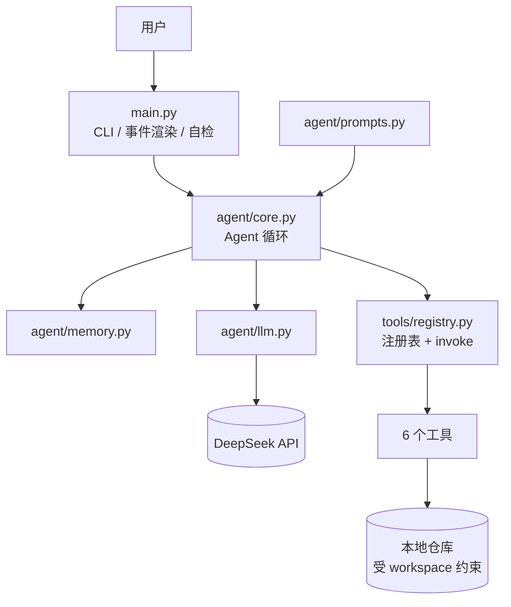
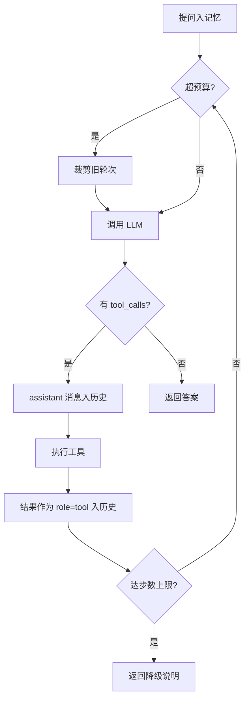

# 设计文档（Design.md）

> 项目：代码解释 Agent · 软件工程 Homework 1
> 配套：[README.md](README.md)（安装与使用）

---

## 1. 需求映射

| 作业要求 | 实现 | 位置 |
|---------|------|------|
| 基本 Agent 循环：输入 → 推理 → 工具调用 → 输出 | 显式 `for` 循环，每步可见可调试 | `agent/core.py: ask()` |
| 支持至少一种工具 | 6 个 | `tools/` |
| 命令行交互 | 交互模式 + 单次提问 + 8 个本地命令 + `--check` | `main.py` |
| 使用 LLM 原生 API | DeepSeek OpenAI 兼容接口，不用框架 | `agent/llm.py` |
| 上下文记忆 | 滑窗裁剪 + 会话落盘 | `agent/memory.py` |
| 错误处理与重试 | 分类重试 + 工具异常回传模型自纠 | `agent/llm.py`、`core.py` |

---

## 2. 架构



依赖单向向下：

```
main.py → agent/core.py → agent/llm.py → 外部 API
                        → agent/memory.py    （纯内存/文件）
                        → agent/prompts.py   （字符串模板）
                        → tools/             （本地执行，不依赖 LLM）
```

**这带来三个实际好处：**

1. **工具层可离线测试**——`tests/offline_test.py` 19 项断言，不花一分钱。
2. **Agent 层不依赖终端**——通过 `on_event` 回调输出，换 Web 界面或写单测零改动。
3. **只有 `llm.py` 与外部通信**——换模型厂商只改 `config.py` 一张表。

---

## 3. Agent 循环的三个关键设计



### 3.1 终止条件用 `tool_calls`，不用 `content`

实测的消息序列：

```
[2] assistant    0 字符    tool_calls=['read_code']
```

**模型请求工具时 `content` 就是空串。** 用 `if not reply.content` 判断，第一轮就会把空串当答案返回，工具一次都不会执行。

### 3.2 `arguments` 必须用服务端原始字符串回填

每条 `role=tool` 消息都要能对应上一个 `tool_call_id`，否则接口返回 400。因此保留原始 `arguments` 字符串：

```python
"function": {"name": c.name, "arguments": c.raw_arguments or "{}"}
```

自己 `json.dumps(c.arguments)` 会改变键序与空格。**这与 git 提交哈希同理：改一个字符，整体就变了。**

### 3.3 三重防护

| 防护 | 值 | 防的是什么 |
|------|-----|-----------|
| `DEFAULT_MAX_STEPS` | 12 | 模型反复读同一文件导致死循环烧钱 |
| `MAX_TOOL_CALLS_PER_STEP` | 6 | 模型单轮请求十几个工具 |
| 工具输出上限 | 6000–24000 字符 | 单次输出撑爆上下文 |

达到上限**不抛异常**，返回可操作说明：

> 已达到最大推理步数（12 步）仍未得出结论。建议把问题范围缩小到具体文件/函数。

---

## 4. 各层设计

### 4.1 配置层

`PROVIDERS` 是一张表，含 `base_url` / 默认模型 / 厂商专属参数：厂商专属项通过 `extra_body` 透传，不污染通用逻辑。读取遵循"环境变量 > `.env` > 代码默认值"，未知 provider 名回退默认值并告警而非崩溃。

### 4.2 LLM 封装层

| 错误 | 重试 | 理由 |
|------|:---:|------|
| 429 / 5xx / 网络超时 | ✅ | 等一会儿就好 |
| 401 / 400 / 402 / 404 | ❌ | 重试一万次结果相同 |

**不分类的代价**：Key 填错时会傻等 `1+2+4≈7` 秒重试 4 次，最后报一句含糊错误。

退避用 `min(2^(n-1), 8) + random(0, 0.6)`，加抖动避免并发重试把限流打得更死。`temperature=0.2`——代码解释要求可复现。

### 4.3 记忆层

**问题**：每轮请求都要重发全部历史，第 20 问会超上下文窗口。

**裁剪规则**：保留 system prompt 与最近 N 条；从最旧处丢弃，且**边界必须落在 `user` 消息上**。

原因是这样一轮交互：

```
[user] → [assistant: tool_calls] → [tool] → [assistant: 答案]
```

从中间切断会留下无对应 `tool_calls` 的 `tool` 消息 → 400。实现即"从想切的位置往后找，直到遇到 `user` 才切"：

```python
while cut < len(body) and body[cut].get("role") != "user":
    cut += 1
```

**验证方式**：注释掉这段搜索，测试立刻报告孤儿 tool 消息。

**token 估算**用 `字符数 ÷ 2.0`，避免引入 `tiktoken`。**必须算上 `tool_calls` 的 `arguments`**——模型请求读长文件时它可能很大，漏算会导致裁剪永不触发。

### 4.4 提示词层

四条原则：

**① 显式给出工具使用策略**——先 `list_symbols` 建骨架、再按行号精读。实测一次 `read_code` 返回 1174 字符，而问题只涉及其中 30 行。

**② 固定输出结构**——分节 + 行号区间 + "未发现明显问题"必须明确写出，抑制模型为凑字数编造问题。

**③ 诚实约束**——阶段 2 实验：把整个文件塞进 prompt、不给工具，问跨文件问题时**模型没有编造**，而是回答"我看不到项目的其他文件"并给出搜索命令。

| 可能的后果 | 是否发生 |
|-----------|:---:|
| 编造假路径假行号 | ❌ 被提示词压住 |
| 把活推回给用户 | ✅ 实际发生 |

**两条路都指向同一结论：跨文件问题模型自己解决不了。** 这正是 `search_code` 存在的理由。

**④ 行为准则**——只读不改、行号必须来自工具真实返回、术语要解释。

### 4.5 工具层

注册表 + 装饰器模式，新增工具三步：写 handler → 写 schema → `@register`。

**一个隐蔽的坑**：`@register` 只在模块被 import 时执行。调试中曾出现"只注册 3 个工具"，检查发现 `search_code.py` 已完整实现（154 行），纯粹是 `loader.py` 漏了导入——**不报错，只是静默不存在**。

schema 的 `description` 是给模型的说明书，质量直接决定调用正确率。

---

## 5. 工具设计要点

### 5.1 `list_symbols` —— 结构化理解的核心

大型文件直接读入要几万 token，且会被无关代码干扰。用 `ast` 提取"符号 → 行号区间"后可先看骨架、再精读相关行：

```
文件：demo/utils.py（解析方式：Python ast）
L11-15  def clean_text(value -> str)   # 折叠连续空白并去掉首尾空格。
L18-37  def parse_age(value -> int)   # 把各种形态的年龄值转成 int。
```

**docstring 摘要是廉价的"相关性判断依据"**——模型不必读函数体就能决定是否相关。

**踩过的坑**：返回类型注解在 `node.returns` 上，**不在 `node.args.returns`**：

```python
if node.returns is not None:   # ✅
if a.returns is not None:      # ❌ AttributeError，所有 Python 文件解析失败
```

错误信息是一句莫名其妙的 `'arguments' object has no attribute 'returns'`，靠离线测试才抓出来。

**已知局限**：非 Python 走正则。实测 C++ 文件（trie 树，76 行）提取失败：

| 实际符号 | 结果 |
|---------|:---:|
| `struct trie` | ✅ |
| `struct trie tr;`（变量声明） | ❌ 误报为类型定义 |
| `void insert(...)` / `int main()` | ❌ 漏报 |

正则是文本匹配，不认识语法。彻底解决需 `tree-sitter`，代价是依赖变重——**这是取舍，不是 bug**。

### 5.2 `read_code` —— 编码容错

真实仓库常混 GBK 注释，`open(encoding='utf-8')` 会抛 `UnicodeDecodeError`：

```python
for encoding in ("utf-8", "utf-8-sig", "gbk", "latin-1"):
    try: return raw.decode(encoding), encoding
    except UnicodeDecodeError: continue
```

`demo/sample_gbk_中文.py` 即测试用例。检索工具复用同一函数，因此也能检索 GBK 文件——**公共逻辑抽成函数的回报**。

行号参数做夹取（模型可能给 0 或负数），并提示"还有 N 行未显示"——否则模型以为已看全，会基于不完整信息下结论。

### 5.3 `search_code`

递归遍历（跳过 `.git`、`node_modules`、>1MB 文件），命中行用 `>>` 标记。返回中报告扫描文件数，**统计口径要诚实**。

**Windows 路径大小写坑**：

```python
file.relative_to(root)                        # ❌ 大小写不一致时抛 ValueError
Path(os.path.relpath(file, root)).as_posix()  # ✅
```

无结果时给建议——返回空字符串会让模型分不清"没找到"还是"工具坏了"。

### 5.4 `run_python` —— 用执行结果替代猜测

四层边界：

| 措施 | 防的是什么 |
|------|-----------|
| 独立子进程 | 主进程被用户代码搞崩 |
| 硬超时（10s） | `while True: pass` 挂死 Agent |
| 输出截断（6000 字符） | 无限打印撑爆上下文 |
| 剔除含 `API_KEY`/`TOKEN`/`SECRET` 的环境变量 | 子进程读到密钥 |

实测：1019 万字符被压到 6112 字符；子进程读假 `API_KEY` 返回 `NOT_VISIBLE`。

**踩过的坑：临时脚本位置。** 教科书式的 `tempfile.mkdtemp()` 在受限环境报 `Permission denied`：

> 实测确认：往"运行时新建的随机名子目录"写文件被拒，写进固定目录正常。

改为固定 `.agent_tmp/` + 进程号命名（并发安全），`finally` 中删除。

**诚实说明**：这不是容器级沙箱（无 namespace / seccomp / 资源限制），仅适合本地自查。

### 5.5 `write_report` —— 双层路径穿越防御

```python
# 第一层：文件名白名单化
stem = _SAFE_NAME.sub("_", filename).strip("._") or "report"
# 第二层：统一路径校验
target = resolve_workspace_path(f"reports/{stem}-{stamp}.md", workspace)
```

实测 `../../../evil` 被写成 `reports/evil-*.md`，未逃出工作区。

**副作用**：白名单过度清洗，`../` 和 `/` 都被替换掉，第二层实际未被触发。安全但丢失原名信息（`a/b/c` → `a_b_c`）。

### 5.6 路径安全边界（所有工具的前置）

`resolve_workspace_path()` 是文件访问的唯一入口：

```python
resolved = (workspace / raw).resolve(strict=False)
ws = workspace.resolve()
if resolved != ws and ws not in resolved.parents:
    raise UnsafePathError(...)
```

工具参数是**模型生成的字符串**，不校验则 `read_code(path="../../../../Windows/System32/...")` 就是任意文件读取漏洞。

**为何不用字符串前缀比较**：

```python
str(resolved).startswith(str(ws))   # ❌
```

1. Windows 大小写不敏感，`c:\users` vs `C:\Users` 会失败
2. `C:\work` 是 `C:\workshop` 的前缀，会误判工作区外目录为区内

`--check` 会**实际发起一次越权攻击**验证这层防护。

---

## 6. 边界情况清单

| 边界 | 处理 |
|------|------|
| 文件不存在 | 明确错误 + 已解析的绝对路径 |
| 路径越权 | 拒绝并说明安全边界 |
| 传目录给 `read_code` | 提示改用 `list_dir` |
| 编码非 UTF-8 | 依次尝试 4 种编码 |
| 文件过大 | 截断 + 提示分段读取 |
| 语法错误文件 | 报错误行号，不崩溃 |
| 行号参数非法 | 夹到合法区间 |
| 正则非法 | 捕获 `re.error` 并建议简化 |
| 检索无结果 | 返回建议而非空串 |
| 工具名不存在（幻觉） | 返回可用工具列表 |
| 参数名错误 | 返回该工具接受的参数名 |
| **模型输出非法 JSON** | **回传解析错误，要求重发** |
| 上下文超预算 | 滑窗裁剪 + 插入说明消息 |
| 执行死循环 / 无限打印 | 硬超时 + 输出截断 |
| 写入路径穿越 | 白名单 + 路径校验双重防御 |

### 错误信息必须附带"怎么修"

| 错误 | 附带信息 |
|------|---------|
| 工具名不存在 | 列出所有可用工具 |
| 参数名不对 | 列出接受的参数名 |
| JSON 解析失败 | 要求重发并说明格式 |

只报错不给方向，模型容易原地打转。

**实测案例**：问一个不存在的文件时，模型依次尝试 `read_code(不存在的.py)`、`read_code('demo')`，两次都收到明确错误，最终如实回答：

> 我这边的工具集里**没有 `list_dir`**（只有 `read_code`），所以虽然报错提示让我用 `list_dir`，我实际无法列出目录内容。

当时确实只装载了 `read_code`——**模型对自身能力边界的判断是准确的**。这次"失败"暴露的是工具缺失，不是模型问题。

---

## 7. LLM 选型

| 硬性条件 | 理由 |
|---------|------|
| 支持 Function Calling | 循环依赖 `tool_calls` 结构化返回 |
| 上下文 ≥ 128K | 容纳文件 + schema + 多轮对话 |
| OpenAI 兼容接口 | 一套 SDK 通用 |
| 国内可直连 | 演示阶段网络稳定 |

**结果**：`deepseek-flash`（1M 上下文，支持 Tool Calls / JSON Output / 思考模式）。

**一个真实的坑**：阿里云百炼的 `qwen3-coder-next` 更便宜且专为代码优化，但官方能力表标注**不支持 Function Calling**。按"选最新最便宜的代码模型"的直觉去选，Agent 第一步就卡死。

这正是把选型做成配置项的价值：**改一行 `LLM_PROVIDER` 就能换走。**

> 参考：[DeepSeek Models & Pricing](https://api-docs.deepseek.com/quick_start/pricing/)、
> [阿里云百炼 qwen3-coder-next](https://help.aliyun.com/zh/model-studio/qwen3-coder-next)

### 思考模式的成本（实测）

| 模式 | prompt | completion |
|------|:---:|:---:|
| 关闭 | 861 | 641 |
| 开启 | 886 | **804**（+25%） |

思考内容由 `reasoning_content` 返回，**与正文共享同一 token 预算**。`max_tokens` 过小时会出现"正文为空 + `finish_reason=length`"——**不报错，只是答案被思考吃光**。

---

## 8. 工程实践

| 实践 | 体现 |
|------|------|
| 类型注解 | 全量 `from __future__ import annotations` |
| 无框架依赖 | 仅 `openai` + `python-dotenv` |
| 事件驱动解耦 | Agent 通过 `on_event` 回调输出 |
| 离线自检 | `--check` 无 Key 无网络即可验证工具层与安全防护 |
| 分层可测 | 工具层不依赖 LLM，Agent 层不依赖终端 |
| 密钥卫生 | `.env.example` 只放占位符，`.env` 被 gitignore |

### 与评分标准的对应

| 维度 | 权重 | 对应 |
|------|:---:|------|
| 功能完整性 | 40% | 6 个工具 + 完整循环 + 第 6 节 15 项边界 + 可复现 demo |
| Agent 架构 | 30% | 第 2–4 节的分层、循环机制、注册表模式、模型可插拔 |
| 代码质量 | 20% | 分类重试 + 错误回传自纠 + 三重防护 + 离线测试 |
| 文档 | 10% | 本文件 + README |

---

## 9. 可扩展方向

1. **多语言精确解析**：接入 `tree-sitter`（直接解决 5.1 的 C++ 提取失败）
2. **向量检索**：`search_code` 是关键字匹配，无法处理语义相似但用词不同的检索
3. **结果缓存**：按文件内容哈希缓存解释，避免重复调用
4. **Web 界面**：架构已解耦，只需新的 `on_event` 渲染器
5. **答案自评**：让模型自检"行号引用是否都来自工具返回"，形成幻觉防线

---

## 10. 已知局限

1. **非容器级沙箱**——`run_python` 能防死循环和无限打印，防不住恶意代码
2. **token 估算不精确**——字符数近似，用于量级控制
3. **非 Python 符号提取粗糙**——实测 C++ 漏报与误报并存
4. **精读策略依赖模型自觉**——仍可能一次读入大文件，靠输出上限兜底
5. **无并发工具执行**——单轮内多个调用顺序执行
6. **无显式计划阶段**——反应式循环，复杂重构任务显式规划会更好
7. **文件名清洗丢失信息**——`../../../evil` → `evil`，安全但看不出原名被改
8. **裁剪会丢失早期对话**——虽有 system 提示告知，早期文件内容需重新读取
